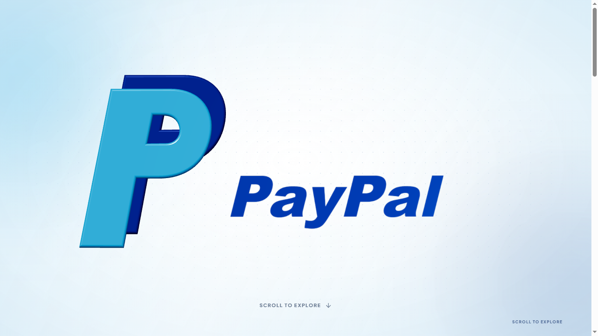
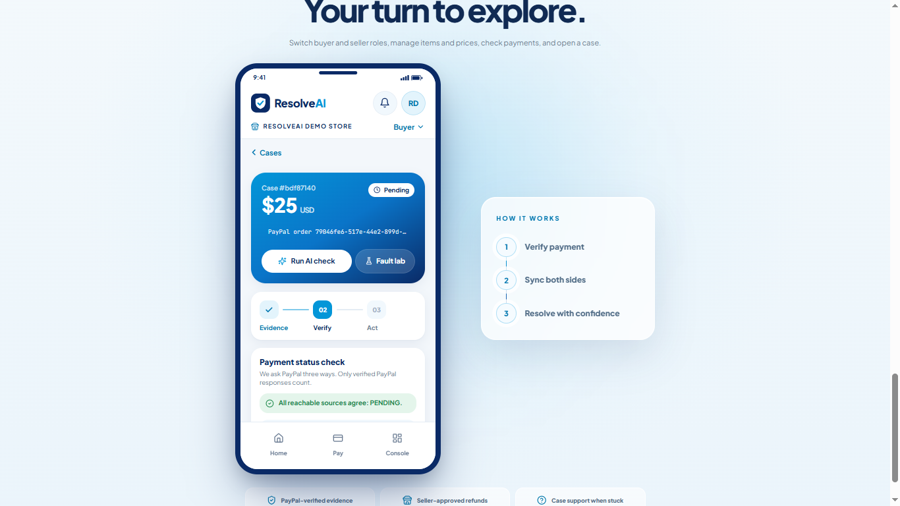
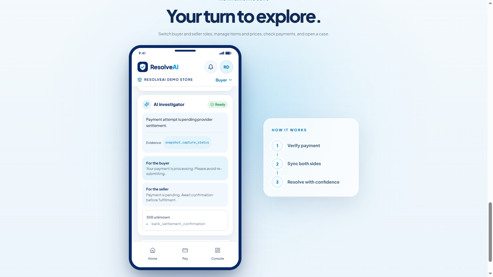
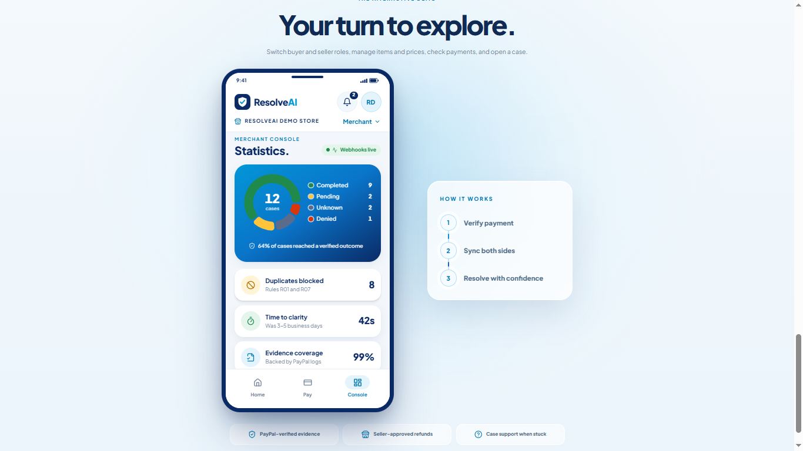

<div align="center">


# ResolveAI

**AI-powered payment recovery and dispute prevention — built on PayPal.**

[](https://resolveai-anss.onrender.com)
[](LICENSE)
[](https://www.python.org)
[](https://react.dev)

> Built for the **PayPal Developer Challenge Hackathon**  
> Sandbox environment only · MIT License

</div>

---

## Overview

Payments fail in ambiguous ways — timeouts, network gaps, duplicate attempts. Most systems either block the user silently or allow dangerous retries. **ResolveAI** sits between the buyer, seller, and PayPal to make uncertainty visible and decisions safe.

When a payment looks stuck, ResolveAI:
1. Fetches authoritative evidence directly from the PayPal API
2. Builds a live event timeline with webhook data
3. Runs a **Gemini AI investigator** to explain what is known, unknown, and why
4. Applies a **deterministic policy engine** to allow or block the next action — retry, void, or refund

The core invariant: **a timeout is never treated as failure.** Unknown state fails closed.

---

## Demo

<!-- Replace with actual screenshot/video once recorded -->
| Scroll Story | Buyer Checkout | AI Investigation | Merchant Console |
|:---:|:---:|:---:|:---:|
|  |  |  |  |

> ▶ **[Watch the 3-minute demo video](https://www.youtube.com/watch?v=PLACEHOLDER)**

---

## Features

### For Buyers
- **Transparent payment status** — not just "pending" but *why* it's pending, with evidence
- **Safe retry gating** — the policy engine blocks accidental duplicate payments before they happen
- **Refund requests** — submit a refund request with one tap; track its approval status in real time

### For Sellers
- **Shared case view** — see exactly what the buyer sees; no support ticket needed
- **Refund approval workflow** — approve or decline buyer refund requests before any money moves
- **Catalog management** — manage items and prices; backend calculates totals at checkout, not the browser

### For Merchants
- **Live console with AG Grid** — all cases, all statuses, real-time SSE updates
- **KPI dashboard** — payment counts by status, reconciled automatically every 30 seconds
- **Fault-Injection Lab** — simulate network timeouts, duplicate captures, and delayed webhooks to test recovery logic without touching real money

---

## Architecture

```
Browser (React 18 + TypeScript)
├── PayPal JS SDK (Smart Buttons — client-side only, no secret in browser)
├── SSE EventSource  ───────────────────────────────────► SSE Event Bus (asyncio.Queue)
│                                                               ▲
└── REST /api/*  ──────────────────────────────────────► FastAPI (Python 3.12)
                                                               │
                                                 ┌─────────────┼─────────────┐
                                                 ▼             ▼             ▼
                                          PayPal REST     Gemini AI      SQLite / PostgreSQL
                                        (Sandbox API)  (Tool-calling)  (9 tables, WAL mode)
                                             │
                                     Background Reconciler
                                     (re-fetches every 30 s)
```

See [`docs/architecture.md`](docs/architecture.md) for full sequence and state diagrams.

---

## Payment State Machine

```
CREATED ──► PENDING ──► COMPLETED ──► REFUND_PENDING ──► REFUNDED
                │                            ▲
                ▼                            │
             UNKNOWN ──► DENIED ──► RETRY_ALLOWED
```

| State | Meaning |
|---|---|
| `CREATED` | Order created in PayPal, not yet captured |
| `PENDING` | Capture sent, awaiting PayPal settlement |
| `UNKNOWN` | No terminal confirmation — timeout or network error |
| `COMPLETED` | PayPal confirmed capture successful |
| `DENIED` | PayPal explicitly denied |
| `RETRY_ALLOWED` | DENIED + human approval to retry |
| `REFUND_PENDING` | Buyer requested refund; awaiting seller approval |
| `REFUNDED` | Refund confirmed via webhook |

---

## Policy Engine

Nine deterministic rules evaluated before every action. If the AI and the policy engine disagree, **policy wins** — always.

| Rule | Condition | Effect |
|---|---|---|
| `R01` | Capture is `COMPLETED` | Retry blocked |
| `R02` | An attempt is already `PENDING` | Retry blocked |
| `R03` | State is `UNKNOWN` | All actions blocked — fails closed |
| `R04` | Capture is `DENIED` | Retry allowed after human approval |
| `R05` | Status is not `COMPLETED` | Refund blocked |
| `R06` | Authorization already captured | Void blocked |
| `R07` | DB constraint | Concurrent retries → 409 |
| `R08` | AI ↔ policy conflict | Policy wins, mismatch logged and shown in UI |
| `R09` | Buyer requests refund on eligible case | State → `REFUND_PENDING` |

---

## AI Investigator

**Model:** `gemini-2.5-flash` via Google AI Studio (free tier, `google-genai` SDK)

The investigator is strictly **read-only**. It has access to exactly five tools:

| Tool | What it fetches |
|---|---|
| `get_order` | Full PayPal order object |
| `get_capture` | Capture status and timestamps |
| `list_webhook_events` | All received webhook events for this order |
| `get_payment_attempts` | Internal retry history |
| `get_case_messages` | Buyer/seller messages on the case |

Every claim in the AI summary must reference a real data field (`evidence_refs`). The UI links each reference back to the evidence timeline. If the AI returns invalid JSON or times out, the **offline investigator** (deterministic rule-based fallback) produces the same schema without any API call.

---

## PayPal Integration

| API | Endpoint | Purpose |
|---|---|---|
| Orders API v2 | `POST /v2/checkout/orders` | Create order |
| Orders API v2 | `POST /v2/checkout/orders/{id}/capture` | Capture payment |
| Orders API v2 | `GET /v2/checkout/orders/{id}` | Authoritative order status |
| Payments API v2 | `GET /v2/payments/captures/{id}` | Capture detail |
| Payments API v2 | `POST /v2/payments/captures/{id}/refund` | Submit refund |
| Notifications API | `POST /v1/notifications/verify-webhook-signature` | Webhook verification |
| OAuth2 | `POST /v1/oauth2/token` | Server-side token (cached, never exposed to browser) |
| **JS SDK** | `sdk/js?client-id=…` | Smart Buttons (client ID only — no secret) |

Idempotency keys (`PayPal-Request-Id`) on every state-changing POST. Webhook events are deduplicated by `paypal_event_id`.

---

## Quick Start

```bash
# 1. Clone
git clone https://github.com/kumarayush0104/ResolveAI.git
cd ResolveAI

# 2. Configure environment
cp .env.example .env
# Edit .env — fill in PAYPAL_CLIENT_ID, PAYPAL_CLIENT_SECRET, GEMINI_API_KEY

# 3. Install Python dependencies
pip install -r requirements.txt

# 4. Build the frontend
cd frontend && npm install && npm run build && cd ..

# 5. Run
uvicorn backend.app.main:app --port 8000
# Open http://localhost:8000
```

> **No separate frontend server needed.** FastAPI serves the built frontend at `/`.

---

## Environment Variables

| Variable | Required | Description |
|---|---|---|
| `PAYPAL_ENV` | Yes | `sandbox` or `live` |
| `PAYPAL_CLIENT_ID` | Yes | From PayPal Developer Dashboard |
| `PAYPAL_CLIENT_SECRET` | Yes | Server-side only — never sent to the browser |
| `PAYPAL_WEBHOOK_ID` | Webhooks | Webhook ID from PayPal dashboard |
| `DEFAULT_CURRENCY` | No | Defaults to `USD` |
| `AI_PROVIDER` | No | `gemini` (default) or `offline` |
| `GEMINI_API_KEY` | AI features | Google AI Studio API key |
| `GEMINI_MODEL` | No | Defaults to `gemini-2.5-flash` |
| `DATABASE_URL` | No | Defaults to `sqlite:///./resolveai.db`. PostgreSQL supported. |
| `JWT_SECRET` | Yes | Random secret for demo JWT signing |
| `ENABLE_LAB` | No | `true` enables Fault-Injection Lab endpoints |
| `PUBLIC_BASE_URL` | Webhooks | Your deployed URL for webhook registration |

---

## Demo Accounts

No passwords. Click the role pill in the top bar to switch instantly.

| Role | Access |
|---|---|
| **Buyer** | Checkout, case view, refund requests |
| **Seller** | Case view, refund approval/decline, catalog |
| **Merchant** | Full console — all cases, metrics, lab |

---

## Project Structure

```
ResolveAI/
├── backend/
│   ├── app/
│   │   ├── agent/          # Gemini investigator + offline fallback
│   │   ├── api/routes/     # FastAPI route handlers
│   │   ├── db/             # SQLAlchemy models and seed data
│   │   ├── paypal/         # PayPal REST adapter (OAuth2, orders, webhooks)
│   │   ├── policy/         # Deterministic policy engine (R01–R09)
│   │   ├── security/       # JWT auth + role permissions
│   │   └── services/       # Reconciler, SSE bus, investigation orchestration
│   └── tests/              # Unit, integration, and scenario tests (31 passing)
├── frontend/
│   └── src/
│       ├── components/     # PhoneFrame, AppBar, StateMachineViz, EvidenceTimeline…
│       ├── pages/          # Checkout, CasePage, Console, Lab, Landing, ScrollStory
│       └── lib/            # API client, auth context, SSE hook
├── docs/                   # Architecture, state machine, threat model, Postman collection
├── render.yaml             # One-click deploy to Render
└── .env.example
```

---

## Registering PayPal Webhooks

After deploying (or using [ngrok](https://ngrok.com) locally):

1. Go to [PayPal Developer Dashboard](https://developer.paypal.com/dashboard/applications/sandbox)
2. Select your sandbox app → **Webhooks** → **Add Webhook**
3. URL: `https://your-domain.com/api/paypal/webhook`
4. Subscribe to: `PAYMENT.CAPTURE.COMPLETED`, `PAYMENT.CAPTURE.PENDING`, `PAYMENT.CAPTURE.DENIED`, `PAYMENT.CAPTURE.REFUNDED`, `CHECKOUT.ORDER.APPROVED`
5. Copy the Webhook ID → paste into `.env` as `PAYPAL_WEBHOOK_ID=`

---

## Running Tests

```bash
pytest backend/tests/ -v
# 31 passed, 1 skipped (live PayPal call — requires sandbox credentials)
```

---

## Key Design Decisions

**Timeout → `UNKNOWN`, never `DENIED`.**  
If the app cannot confirm that PayPal denied the payment, it uses `UNKNOWN` and blocks all actions. No false failure, no dangerous retry.

**Persist before request.**  
A payment attempt row is written to the database *before* the PayPal API call. If the process crashes mid-flight, the reconciler will recover the actual status.

**AI is advisory, policy is authoritative.**  
The Gemini investigator proposes an interpretation. The policy engine verifies it. Any conflict is logged and surfaced in the UI — the AI recommendation is never the final word.

**Server-side pricing.**  
Cart totals are calculated on the backend from current catalog prices, not trusted from the browser. Prices are snapshotted into the order at purchase time.

**Transparent simulation.**  
Every event injected by the Fault Lab carries `is_simulated: true`. A striped `SIMULATION` banner appears across the case view and on every affected timeline event.

---

## Deployment

Deployed on **Render** via [`render.yaml`](render.yaml). Push to `main` → auto-deploy.

> Free tier cold starts may take 30–60 seconds on first load.

---

## Docs

| Document | Description |
|---|---|
| [`docs/architecture.md`](docs/architecture.md) | System overview, sequence and state diagrams (Mermaid) |
| [`docs/state-machine.md`](docs/state-machine.md) | Full state machine with refund flow and core invariants |
| [`docs/threat-model.md`](docs/threat-model.md) | Trust boundaries and security mitigations |
| [`docs/known-limitations.md`](docs/known-limitations.md) | Sandbox constraints, PayPal API differences, known gaps |
| [`docs/test-scenarios.md`](docs/test-scenarios.md) | Manual and automated test scenarios (31 passing) |
| [`docs/postman/`](docs/postman/) | Postman collection for all API endpoints |
| [`CONTRIBUTORS.md`](CONTRIBUTORS.md) | Team members and their roles |

---

## Team

Built by:

| Name | Role |
|---|---|
| **Ayush Kumar** | Backend · PayPal integration · Policy engine |
| **Shyam Kumar** | AI investigator · Fault lab · State machine |
| **Palak Soni** | Frontend · UI/UX · Scroll story · Visualizations |

---

## License

MIT © 2026 Ayush Kumar, Shyam Kumar, Palak Soni
