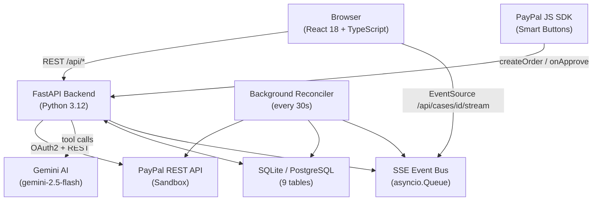
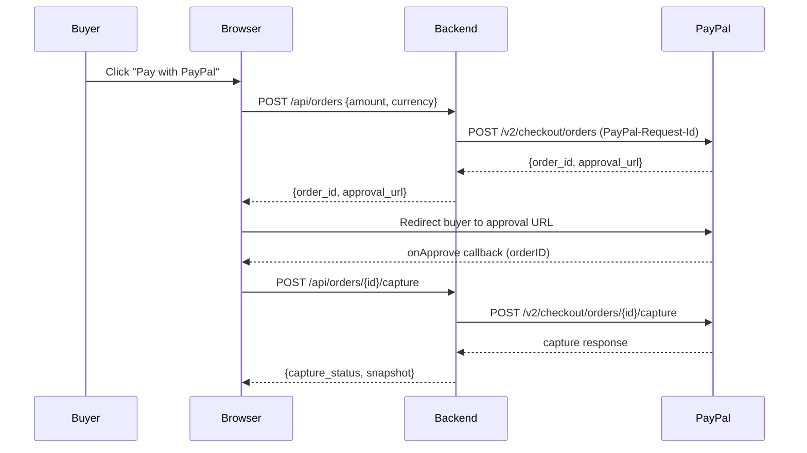
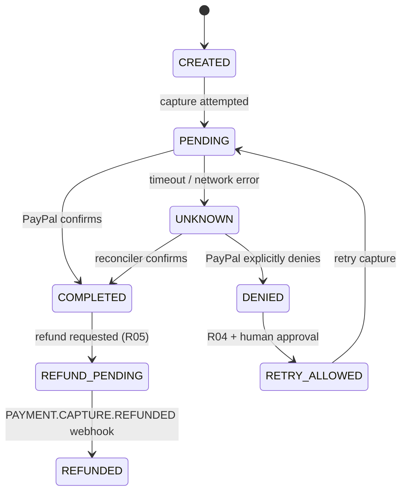

# ResolveAI — Architecture

## System Overview

## Request Flow — Checkout

## State Machine

## Policy Rules

| Rule ID | Condition | Effect |
|---|---|---|
| `R01_COMPLETED_BLOCKS_RETRY` | capture COMPLETED | retry blocked |
| `R02_PENDING_BLOCKS_RETRY` | any attempt PENDING | retry blocked |
| `R03_UNKNOWN_FAILS_CLOSED` | timeout / conflict | all actions blocked |
| `R04_DENIED_ALLOWS_RETRY` | explicitly DENIED | retry allowed after approval |
| `R05_REFUND_ONLY_COMPLETED` | refund requires COMPLETED | otherwise blocked |
| `R06_VOID_ONLY_UNCAPTURED_AUTH` | void requires auth not captured | otherwise blocked |
| `R07_ONE_ACTIVE_ATTEMPT` | DB constraint | concurrent retries → 409 |
| `R08_AI_IS_ADVISORY` | AI vs policy conflict | policy wins, logged |
| `R09_REFUND_REQUESTED_NE_COMPLETED` | refund request accepted | state = REFUND_PENDING |
